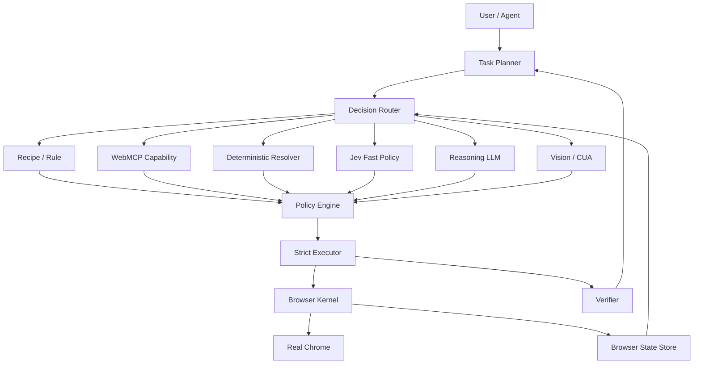

# browser-agent-next

Agent-native browser runtime for real Chrome.

This project is a clean-slate evolution of `browser-agent`, centered on five stable abstractions:

1. **State** — typed, scoped browser observations with explicit coverage.
2. **Identity** — persistent refs backed by strong browser identities.
3. **Action** — typed actions referencing observations, not ad-hoc selectors.
4. **Effect** — side effects and authorization are modeled independently from model confidence.
5. **Verification** — completion must be proven by evidence, not claimed by a model.

## Status

The repository is in the **runtime foundation** phase.

Implemented in the initial scaffold:

- canonical BrowserState types;
- observation coverage model;
- opaque state revisions;
- typed action/effect/verification contracts;
- structured runtime error taxonomy;
- in-memory PersistentRefStore foundation;
- conservative effect policy;
- architecture, invariants and migration roadmap.

Not implemented yet:

- Chrome Extension / Native Messaging transport;
- live AX + DOM perception;
- persistent ref integration with a real page;
- state delta;
- strict executor;
- Jev fast policy;
- WebMCP;
- vision fallback.

## Architecture



The intended invariant is:

> **AI decides. Code authorizes. Executor proves identity. Browser performs. Verifier proves outcome.**

## Development

Requirements:

- Node.js 20.19+
- pnpm

```bash
pnpm install
pnpm typecheck
pnpm test
pnpm build
```

Start with:

- [Design](./docs/DESIGN.md)
- [Architecture](./docs/ARCHITECTURE.md)
- [Invariants](./docs/INVARIANTS.md)
- [Roadmap](./docs/ROADMAP.md)
- [ADR-0001](./docs/adr/0001-runtime-boundaries.md)
