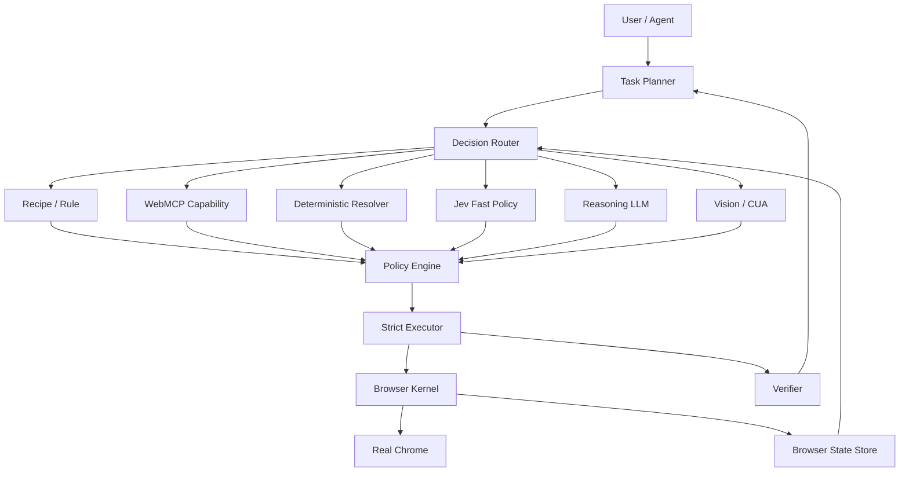

# browser-agent-next

Agent-native browser runtime for real Chrome.

This project is a clean-slate evolution of `browser-agent`, centered on five stable abstractions:

1. **State** — typed, scoped browser observations with explicit coverage.
2. **Identity** — persistent refs backed by strong browser identities.
3. **Action** — typed actions referencing observations, not ad-hoc selectors.
4. **Effect** — side effects and authorization are modeled independently from model confidence.
5. **Verification** — completion must be proven by evidence, not claimed by a model.

## Status

The repository is in **Phase 1 — Perception IR**.

Foundation completed so far:

- canonical BrowserState contracts;
- explicit observation coverage;
- persistent ref store and tombstones;
- bounded observation state store;
- keyed state deltas;
- strict target preflight;
- effect policy;
- evaluation fixtures and runtime trace schema.

Perception work now implemented:

- source-neutral DOM / AX / adapter candidate model;
- strong-evidence-only cross-source merge;
- linked persistent identities;
- canonical BrowserObservation assembler;
- conservative expected-source coverage.

Live Chrome perception is the next step.

## Architecture



> **AI decides. Code authorizes. Executor proves identity. Browser performs. Verifier proves outcome.**

## Development

Requirements:

- Node.js 20.19+
- pnpm 10.34.5

```bash
pnpm install
pnpm typecheck
pnpm test
pnpm build
```

## Documentation

- [Design](./docs/DESIGN.md)
- [Architecture](./docs/ARCHITECTURE.md)
- [Perception IR](./docs/PERCEPTION.md)
- [Invariants](./docs/INVARIANTS.md)
- [Evaluation](./docs/EVAL.md)
- [Roadmap](./docs/ROADMAP.md)
- [Progress](./docs/PROGRESS.md)
- [ADR-0001](./docs/adr/0001-runtime-boundaries.md)
