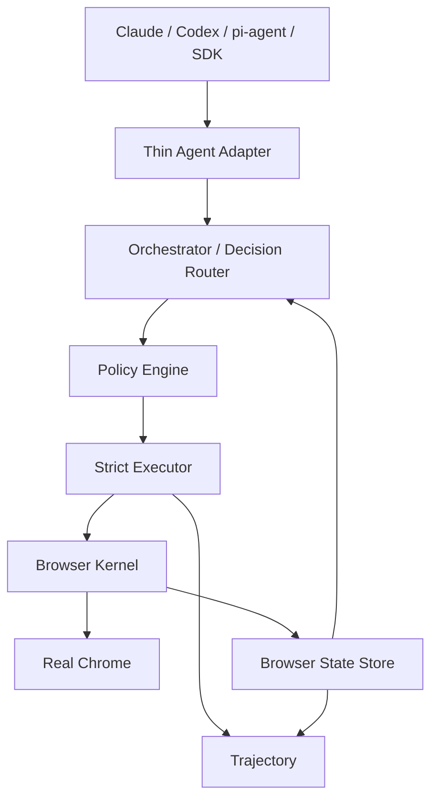

# Architecture



The project separates Planner, Decision Provider, Policy Engine, Strict Executor, Browser Kernel and Verifier.

## Canonical state

BrowserState is the source of truth. Text snapshots are views.

```text
AX ─┐
DOM ├── Semantic Merge ── BrowserObservation ── compact/form/delta/model views
Adapters ┤
CDP ─────┘
```

Every observation declares coverage. Partial or truncated observations must not masquerade as complete action spaces.

## Identity

Persistent refs are object identities, not selectors. A ref may survive same-document updates when the strong identity survives, but it must never be rebound to a same-looking replacement element.

Persistent refs are continuity primitives, not freshness proofs.

## Strict execution

Strict actions reference:

```text
observedRevision + persistent ref
```

The runtime retrieves expected semantics from its own stored observation. The caller cannot forge trusted expected semantics.

Strict execution validates document/frame compatibility, strong identity, critical live semantics, visibility, enabled state, viewport, hit test and policy before dispatching input.

Strict mode does not require the whole-page revision to be unchanged: unrelated dynamic mutations must not make normal apps unusable.

## Effects and authorization

Effects are independent from model confidence:

```text
read
local-ui
navigation
draft-mutation
download
external-mutation
irreversible
credential
file-egress
permission
payment
unknown
```

Arbitrary click effects may be unknown. Unknown is explicit and is never silently downgraded.

## Intelligence ladder

```text
Exact Recipe / Rule
↓
Page semantic capability
↓
Deterministic browser primitive
↓
Jev bounded semantic choice
↓
Reasoning LLM
↓
Vision / Computer Use
```

Use the lowest intelligence level that safely solves the step.
